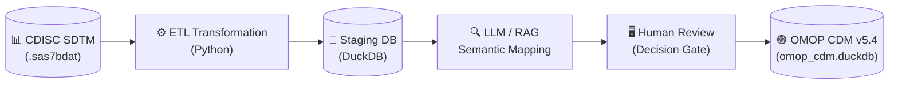

# 🏥 CDISC to OMOP Common Data Model (CDM) Pipeline


[](https://github.com/MrCosta77/CDISC-to-OMOP/actions/workflows/quality.yml)


An end-to-end clinical data engineering pipeline with production-oriented controls, demonstrating the transformation of clinical trial data from the **CDISC SDTM standard** into the **OMOP Common Data Model (CDM) v5.4**, bridging the gap between isolated clinical research and global Real-World Evidence (RWE).

## Portfolio evidence — 30-second review

| Question | Evidence in this repository |
|---|---|
| **What problem does it address?** | Preserves trial context while transforming SDTM records into an OMOP CDM structure suitable for governed downstream RWE exploration. |
| **What goes in?** | Synthetic portfolio SDTM `.sas7bdat` domains plus a locally supplied official OHDSI Athena vocabulary export. Source datasets and licensed vocabularies are intentionally not committed. |
| **What comes out?** | An atomically published `data/cdisc_omop.duckdb` with OMOP clinical tables, run audit data, mapping decisions, provenance, and record-level SDTM lineage. |
| **How is it verified?** | [`pytest` contracts](tests/) cover schema, input, mapping, lineage, temporal semantics, units, orchestration, and atomic publication; [GitHub Actions](.github/workflows/tests.yml) runs the automated quality gate. |
| **What demonstrates governance?** | LLM output remains a proposal. A human approval gate controls reusable mappings, and rejected terms remain governed policy rather than silently entering clinical tables. |
| **What are the limits?** | Portfolio/reference implementation evaluated with synthetic study data. It is not a validated clinical production system, regulatory submission tool, or substitute for institutional validation and security controls. |

The [reproduction instructions](#how-to-reproduce) separate committed code from
locally supplied clinical inputs and vocabulary assets. The controls demonstrate
engineering behaviour under the documented test conditions; they do not by
themselves establish production or regulatory fitness.

## 🚀 Quick Start

Get the CDISC to OMOP pipeline running locally:

```bash
# 1. Clone the repository
git clone https://github.com/MrCosta77/CDISC-to-OMOP.git
cd CDISC-to-OMOP

# 2. Create and activate a virtual environment
python -m venv venv
venv\Scripts\activate  # Windows
# source venv/bin/activate # Mac/Linux

# 3. Install dependencies
pip install -r requirements.txt

# 4. Set up environment variables
cp .env.example .env

# 5. Run the pipeline (ETL + AI Mapping)
python main.py
```

## 📐 Architecture Flow



## 🧠 Core Architecture & Engineering Highlights
* **Human Review Gate:** AI proposals are stored in `mapping_decision`, linked to affected events, and must be explicitly approved before entering `approved_mapping_set`. Only approved mappings are applied on a subsequent run and recorded in `mapping_provenance`.
* **Reproducible Candidate Selection:** Deterministic and retrieval candidates exclude invalid or expired concepts and relationships, use stable Concept ID tie-breaking, and record the vocabulary, prompt and run versions. The configured confidence threshold classifies low-confidence candidates before review.
* **Reusable Human Policy:** Active approvals are applied before the LLM phase; active rejections are detected before retrieval, so previously rejected terms do not call the model again. AE mapping uses controlled `AEDECOD` while retaining verbatim `AETERM`; CM mapping uses normalized `CMDECOD` while retaining verbatim `CMTRT`.
* **Pinned OMOP Schema:** Installs all 39 tables from the OHDSI CDM v5.4.3 field specification. Populated tables use explicit DuckDB types, required fields, primary keys, staging tables, and relational acceptance checks.
* **Globally Atomic Database Builds:** Every `main.py` run builds the schema, Athena vocabularies, audit metadata, mapping decisions, clinical tables, and lineage in an isolated DuckDB candidate. The published database is replaced at file level only after the complete candidate passes validation; a failed run leaves the previous database untouched.
* **Explicit Trial Provenance:** Clinical SDTM records, including actual visits from SV, use the Standard `Case Report Form` Type Concept. Observation periods derived from the DM reference period use `Standard algorithm`; the source-to-type matrix is centralized and tested.
* **Record-Level SDTM Lineage:** Every published person, observation period, visit, condition, drug, and measurement has exactly one validated row in `source_record_lineage`, preserving the SDTM domain, subject, sequence/key, source file, verbatim value, mapping value, and publication `run_id`. Drug rows additionally distinguish a source-recorded end from an administratively censored or convention-derived OMOP end date.
* **Explicit Unit and Source Semantics:** CDISC units are mapped through a reviewed, case-sensitive dictionary to Standard `Unit` Concepts. A supplied but unknown unit is published as concept ID `0`, while a genuinely absent unit remains `NULL`; original values and source concept fields are retained explicitly.
* **Clinical Time Rigor:** Derives unbiased `OBSERVATION_PERIOD` spans using strict CDISC Demographics reference dates (`RFSTDTC`/`RFENDTC`), preventing longitudinal biases from past medical history events.
* **Software Engineering Best Practices:**
  * Parameterized SQL queries to prevent SQL injection.
  * Comprehensive `.env` configuration management.
  * Automated `pytest` suites ensuring mathematical determinism and collision resistance for 64-bit ID generation.
  * Standardized `logger` writing synchronized, timestamped execution trails to `logs/pipeline.log`.
* **Unified SQL Engine:** Publishes normalized tables transactionally into **DuckDB**, with a standalone structural and relational acceptance command.

## 📂 Repository Structure

* `data/raw/`: Input `.sas7bdat` clinical trial files (ignored by git).
* `data/processed/<run_id>/`: Normalized OMOP CSV tables isolated by execution.
* `resources/omop_cdm_v5_4/`: Pinned OHDSI v5.4.3 field specification, verified by SHA-256.
* `src/omop/`: DDL generation and schema-contract validation for DuckDB.
* `src/etl/`: Core transformation scripts (`person`, `condition`, `drug`, `measurement`, `observation_period`, `visit`, `link_visits`, `source_lineage`, `build_database`).
* `src/mapping/`: 
  * `deterministic_mapping.py`: OHDSI vocabulary exact matchers.
  * `llm_shared.py`: Parameterized SQL retrieval and mathematical confidence scoring.
  * `llm_*.py`: AI semantic agents for distinct clinical domains.
* `src/analytics/`: RWE analytical scripts (`rwe_queries.py`).
* `src/quality/`: Standalone acceptance checks for the published CDM.
* `src/utils/`: Configuration (`config.py`), central algorithms (`helpers.py`), file-level atomic publication (`atomic_database.py`), audit setup (`setup_audit.py`), and standardized logging (`logger.py`).
* `tests/`: Pytest suites verifying core data engineering functions.
* `main.py`: Idempotent orchestrator with a unique `run_id` and run-level audit trail.

## 🛠️ Pipeline Execution Flow

1. **Phase 1: Isolated Schema, Vocabularies & Audit Setup** — Creates a run-specific candidate database beside the published file, installs the pinned 39-table OMOP CDM v5.4.3 contract, loads typed vocabularies, and builds audit metadata. The published database is not opened for writing.
2. **Phase 2: Structural ETL** — Validates ten raw CDISC domains and transforms DM, AE, MH, EX, CM, LB, VS, EG and SV into OMOP clinical tables. DS is validation-only: its one final disposition record per subject verifies cohort coverage and timeline consistency, but no unsupported OMOP disposition record is invented. De-identified `STUDYID + SITEID` values become `CARE_SITE` source keys linked from `PERSON`; no site name, location, or facility type is invented. Observation periods come from DM, actual visits come from SV, and event links are added only when the visit is explicit or temporally unambiguous. A record-level SDTM lineage bridge is generated before mapping.
3. **Phase 3: Semantic Mapping** — Applies deterministic mappings and previously approved human mappings. The LLM only proposes candidates for the remaining orphan terms; pending proposals stay as concept ID `0` in the published clinical tables.
4. **Phase 4: Validated Publication** — Loads CSV outputs into temporary staging tables, casts them into the official contract, validates required fields, keys, dates, concepts, relations, complete lineage coverage, and one matching current-run provenance row for every non-zero clinical mapping. Only then does the orchestrator record success and atomically replace `cdisc_omop.duckdb` at file level. Any exception removes the candidate and preserves the previous database.

## ⚙️ How to Reproduce

**1. Clone the repository:**
```bash
git clone https://github.com/MrCosta77/CDISC-to-OMOP
cd CDISC-to-OMOP
```

**2. Create an isolated environment and install dependencies (Windows PowerShell):**
```bash
py -m venv .venv
.\.venv\Scripts\python -m pip install -r requirements-dev.txt
```

**3. Configure the Environment:**
Copy the example environment file and adjust if necessary (e.g., select your local LLM model and confidence threshold).
```bash
Copy-Item .env.example .env
```

**4. Run Unit Tests (Optional but recommended):**
Ensure the mathematical core is intact before running the ETL.
```bash
.\.venv\Scripts\python -m pytest -v
```

`requirements.txt` contains the exact direct runtime versions used by the
pipeline. `requirements-dev.txt` adds the equally pinned test and notebook
tools used by CI and local development.

**5. Place your raw data:**
Ensure your source `.sas7bdat` files and OHDSI vocabularies are inside the `data/raw/` and `data/omop_vocab/` directories, respectively.

**6. Run the full automated orchestrator:**
```bash
.\.venv\Scripts\python main.py
```
Each execution receives a unique `run_id`. A successfully published run stores
its status, input manifest, Git commit, Git dirty state, a SHA-256 manifest of
the executable Python source tree, configuration snapshot, output counts, and
mapping provenance in DuckDB. By default, publication is rejected when Git has
uncommitted source changes, so the recorded commit identifies the executed
code. For an explicit development-only run, set `ALLOW_DIRTY_RUN=true`; the run
will remain visibly marked dirty and retain its source fingerprint. Failed
candidates are deliberately discarded so they cannot alter the published
database; their step and error trail remains
available in `logs/pipeline.log`.

Publication also fails closed when Git is unavailable or the repository state
cannot be determined. `ALLOW_DIRTY_RUN=true` is the explicit development-only
override for both modified and unknown Git states; such a run retains the source
manifest but must not be treated as a reproducible release.

The append-only `pipeline_run` ledger is carried from the previous published
database into each new atomic candidate before the current run is added. This
preserves execution history across successful rebuilds. Clinical tables,
`source_record_lineage`, and event-level `mapping_provenance` intentionally
describe only the currently published dataset and its `run_id`.

Each full execution also receives its own `data/processed/<run_id>/` directory.
No run can accidentally consume CSVs left by an earlier run. A failed run keeps
its isolated directory for diagnosis, but that directory is never reused by a
later execution.

The build temporarily requires enough free disk space for the published database
and one complete candidate. On Windows, close RStudio, database browsers, or
other processes holding `cdisc_omop.duckdb` open before final publication. If
the replacement is blocked, the run fails without overwriting the previous
database.

The orchestrator validates all ten SDTM input contracts before ETL, including
non-blank subject/sequence keys and mapping-critical clinical terms, CDISC Race
terminology, and the consistency of `STUDYID`, `SITEID`, `SUBJID`, and
`USUBJID`. DS participates in this acceptance gate but is not directly
published to an OMOP clinical table. To run this
gate independently:
```powershell
.\.venv\Scripts\python -m src.quality.validate_cdisc_inputs
```
The CI suite uses `tests/fixtures/golden_cdisc.json`, so schema, key, timeline,
controlled-terminology and unit regressions are testable without proprietary
SAS files or Athena.

**7. Validate the published OMOP CDM:**
```powershell
.\.venv\Scripts\python -m src.quality.validate_cdm
```

**8. Review LLM proposals:**
```bash
.\.venv\Scripts\python -m src.mapping.review_mappings list --run-id latest
```
Inspect all active reusable approval and rejection rules:
```powershell
.\.venv\Scripts\python -m src.mapping.review_mappings rules
```
Approve a proposal (optionally replacing the proposed Concept ID):
```powershell
.\.venv\Scripts\python -m src.mapping.review_mappings approve 1 --reviewer "Reviewer Name" --reason "Validated against the Standard Vocabulary" --concept-id 201826
```
Or reject it:
```powershell
.\.venv\Scripts\python -m src.mapping.review_mappings reject 1 --reviewer "Reviewer Name" --reason "Candidate adds unsupported clinical specificity"
```
Run `main.py` again after review. The next run applies only the active mappings in
`approved_mapping_set`. After approving or rejecting a proposal, export the
active rules to the versioned, non-clinical artifact:
```powershell
.\.venv\Scripts\python -m src.mapping.review_mappings export-rules
```
Commit `resources/mapping_rules.json` with the review change. A fresh database
imports this artifact automatically during `main.py`, before semantic mapping.
The import is idempotent and refuses rules reviewed against a different Athena
extract. It can also be tested explicitly:
```powershell
.\.venv\Scripts\python -m src.mapping.review_mappings import-rules
```

**9. Run RWE Analytics:**
Generate cohort demographics, AE-domain adverse-event frequencies, domain-separated
LB/VS/EG measurement summaries, and rescue-medication phenotyping. The analytics
join `source_record_lineage`: Medical History is not counted as an adverse event,
and repeated measurements are not labelled as baseline without an explicit baseline
flag or derivation.
```bash
python src/analytics/rwe_queries.py
```

### Drug exposure end-date policy

`drug_exposure_end_date` is required by OMOP CDM 5.4. The ETL applies a
source-faithful hierarchy:

1. An explicit `EXENDTC` or `CMENDTC` is published unchanged and copied to
   `verbatim_end_date` (`SOURCE_RECORDED`).
2. A CM record with no `CMENDTC` is accepted only when `CMENRTPT=ONGOING` and
   the source supplies its assessment point in `CMENTPT`. Its required OMOP end
   date is censored at `CMENTPT` (`ADMINISTRATIVE_CENSORING_CMENTPT`). The point
   must fall within the subject's DM reference period. This is a last-known
   observation boundary, not an asserted clinical stop date, so
   `verbatim_end_date` remains null.
3. An EX administration without `EXENDTC` uses `EXSTDTC` as its end date
   (`OHDSI_ADMINISTRATION_SAME_DAY`), following the OHDSI THEMIS convention for
   administration records. `verbatim_end_date` remains null.
4. A CM record missing both an end date and an explicit ongoing indicator blocks
   the batch instead of silently inventing duration.

The chosen values and derivation labels are retained in `source_record_lineage`
as `source_end_date`, `published_end_date`, and `end_date_derivation`. No
`days_supply`, prescription duration, or clinical discontinuation date is inferred.

## OMOP Schema Provenance

The schema metadata is pinned to the official
[OHDSI CommonDataModel v5.4.3 release](https://github.com/OHDSI/CommonDataModel/releases/tag/v5.4.3),
commit `746a15e0fb36a95ba6cc0993737f1273bbad92f2`. The vendored field
specification is the OHDSI source of truth used to generate the DDL and is
verified at runtime with SHA-256
`2b763c7a2aeb309372c1564350939551531318e2078fd4443e03b2741e79b77c`.
The file is exempt from Git end-of-line normalization so the official byte
stream and its checksum remain identical on Windows and Unix checkouts.
Logical OMOP `integer` fields are represented as DuckDB `BIGINT` so generated
64-bit identifiers remain valid.

## Athena Vocabulary Provenance

The exact Athena extract loaded by the pipeline is pinned in
`resources/athena_vocabulary_manifest.json`. It contains SHA-256 checksums for
`CONCEPT`, `CONCEPT_RELATIONSHIP`, `VOCABULARY`, `DOMAIN`, `CONCEPT_CLASS`, and
`RELATIONSHIP`, plus the individual vocabulary release labels from Athena.
Every vocabulary load verifies all six files before replacing any database
tables. `cdm_source.vocabulary_version`, portable mapping rules, and the run
manifest use the resulting `Athena-<fingerprint>` identity.

When Athena is intentionally replaced, generate a new manifest first:
```powershell
.\.venv\Scripts\python -c "from src.utils.config import VOCAB_DIR, VOCAB_MANIFEST_PATH; from src.utils.vocabulary_identity import write_vocabulary_manifest; print(write_vocabulary_manifest(VOCAB_DIR, VOCAB_MANIFEST_PATH)['version_label'])"
```
Existing rules will then fail closed until they are reviewed/exported against
the new vocabulary identity; do not edit either fingerprint by hand.

## CDISC Type Concept Provenance

Type Concepts describe where a CDM record came from, not the clinical meaning
of the event. The current synthetic study uses this explicit matrix:

| OMOP target | CDISC source | Type Concept | Rationale |
|---|---|---|---|
| `CONDITION_OCCURRENCE` | AE, MH | `32809` — Case Report Form | Direct eCRF/SDTM clinical records |
| `DRUG_EXPOSURE` | EX, CM | `32809` — Case Report Form | Direct eCRF/SDTM medication records |
| `MEASUREMENT` | LB, VS, EG | `32809` — Case Report Form | Current synthetic eCRF/SDTM measurement feed |
| `VISIT_OCCURRENCE` | SV | `32809` — Case Report Form | Actual visits reported in SDTM SV |
| `OBSERVATION_PERIOD` | Derived from DM reference dates | `32880` — Standard algorithm | Constructed deterministically from RFSTDTC/RFENDTC |

The assignments live in `src/omop/type_concepts.py`. A future direct central-
laboratory feed must receive an explicit assignment (for example, `32856` —
Lab) rather than silently inheriting the current LB assumption.

SDTM SV does not identify an inpatient, outpatient, emergency or other OMOP
visit setting in this source. Therefore `visit_concept_id` is published as `0`
(`No matching concept`) while `visit_source_value`, the actual SV dates and the
Case Report Form Type Concept preserve what the source does support. Every
explicit LB/VS/EG `(USUBJID, VISITNUM)` must match an SV record; an unknown
reference blocks the batch rather than silently dropping the visit link.

## Unit and Source Concept Contract

The reviewed mappings live in `src/omop/unit_concepts.py`. Publication checks
that every non-zero `unit_concept_id` is a current Standard Concept in the
OMOP `Unit` domain. SDTM test, condition, and drug names in this synthetic feed
are local text rather than codes from OMOP-supported source vocabularies, so
their corresponding `*_source_concept_id` is explicitly `0`; the verbatim
source values remain available in the `*_source_value` fields.
